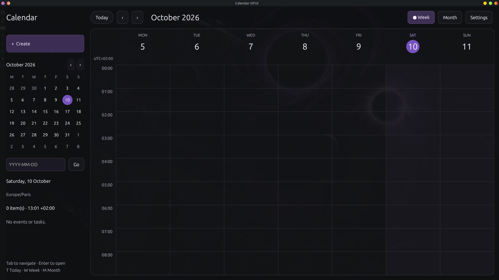

# Calendar GPUI

Calendar GPUI helps individuals organize their schedules in a local desktop app.
It opens to a week timeline and daily agenda for planning upcoming commitments.
A six-row month view makes it easy to scan dates across a full calendar period.
The compact dark interface pairs a mini-calendar sidebar with a spacious timeline,
smaller text, violet date highlights, and a subtly transparent window background.
Desktop transparency requires support from the window manager or compositor.
Create timed events and tasks, then edit or remove them as plans change.
Add notes and meeting links, and track task completion in the same calendar.
Review weekends, the current time, and French national holidays at a glance.
Choose an IANA display time zone while each item's original zone is retained.
Calendar data stays in a validated local JSON file, available without a cloud account.

---

## Quickstart

### Install

Install stable Rust with [rustup](https://rustup.rs/). On Linux, install the native
GPUI development dependencies for X11/XCB, Wayland, xkbcommon, Vulkan, fontconfig,
and OpenSSL, plus a C/C++ compiler, CMake, and pkg-config. On macOS, install Xcode
and its command-line tools. Run the app in a graphical desktop session.

### Run

From the project directory, launch the desktop app with:

```bash
cargo run --locked
```
