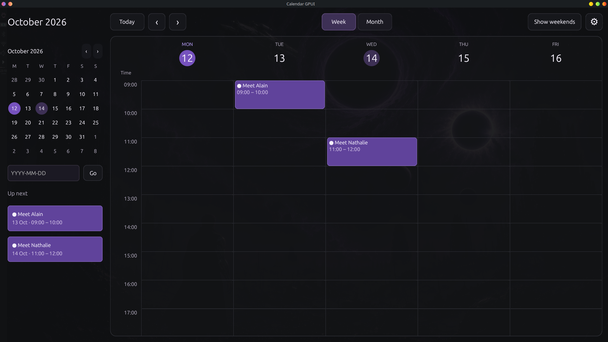

# Calendar GPUI

---

Calendar GPUI is a desktop calendar for people who plan their days locally.
It opens to a week view at 07:00 for arranging appointments and commitments.
Scroll with the mouse or trackpad to reach any hour of the full 24-hour day.
The week shows Monday through Friday by default; use Show weekends to include Saturday and Sunday.
A month view helps you review dates over a longer period.
Create calendar entries, then adjust or delete them as your plans change.
Keep notes and meeting links alongside each calendar entry.
Press Enter in the entry editor to save. The sidebar shows the next three upcoming entries.
Weekends and French national holidays provide context for planning.
Start and end share one row; the desktop uses your computer's time zone automatically.
Your calendar stays on your computer and needs no cloud account.
Other applications and AI agents can manage events through a local MCP server.

---

## Quickstart

### Install

Install stable Rust. Desktop builds need GPUI's native libraries: on Linux,
X11/XCB, Wayland, xkbcommon, Vulkan, fontconfig, OpenSSL, and C/C++ build tools;
on macOS, Xcode and its command-line tools.

```bash
cargo build --locked --bin calendar-gpui
cargo build --locked --no-default-features --bin calendar-mcp
```

### Run

Launch the desktop app in a graphical session:

```bash
cargo run --locked --bin calendar-gpui
```

MCP clients launch `target/debug/calendar-mcp` over stdio.
See the [Python](MCP-docs/python.md) and [TypeScript](MCP-docs/typescript.md) examples.
Both use the same default calendar file as the app;
set `CALENDAR_GPUI_DATA_FILE` to choose another file.
